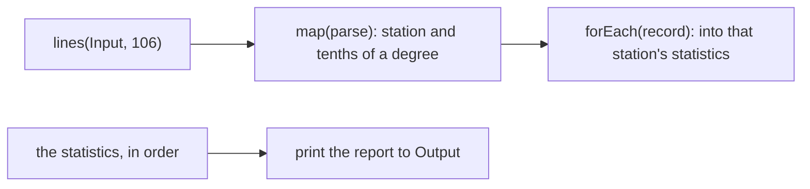

# One Billion Row Challenge

Computes the minimum, mean and maximum temperature of every weather station
in a file in the [original 1BRC format](https://github.com/gunnarmorling/1brc),
twice: `one-billion-rows` is two zrx programs, and `one-billion-rows-zig` is
the same aggregate written against `std` alone, to be measured against it.
Built with Zig **0.17.0**; no third-party dependencies.

```sh
zig build -Doptimize=ReleaseFast
printf 'Zurich;2.0\nBasel;-0.1\nBasel;0.0\n' > measurements.txt
./zig-out/bin/one-billion-rows measurements.txt
./zig-out/bin/one-billion-rows-zig measurements.txt
# {Basel=-0.1/0.0/0.0, Zurich=2.0/2.0/2.0}
```

Exit status 0 with the report on stdout, or 2 with `fatal: <error>` on stderr
and nothing on stdout: a malformed line, a line that is too long, more than
10,000 stations, or a file that cannot be read.

## The pipes

All of the zrx side is in [`src/app.zig`](src/app.zig):

```zig
/// Needs `Input` and the `*Stations` the statistics are kept in.
pub const measuring = program(lines(Input, domain.max_line), .{
    map(parse),
    forEach(record),
});

/// Needs the `*Stations` and `Output`.
pub const reporting = program(fromProducer(domain.Report, inOrder), .{print(Output, "{f}\n")});
```



- `parse` takes a line apart and `record` updates one station. Each is a few
  lines over [`src/domain.zig`](src/domain.zig), which holds what both
  executables share: how a measurement is written, the table of stations and
  the report. It does not import zrx.
- The table is a `*Stations` dependency. Its memory is allocated before the
  first line is read: a name is copied the first time it is seen, and nothing
  is allocated per measurement.
- The input is a `fileReader` binding and the output `stdout`; a test gives
  the same two programs a fixed reader and writer.
- Temperatures are integer tenths. The mean is rounded to the nearest tenth,
  ties toward positive infinity, and the report is in Java's UTF-16 order, as
  the challenge's reference prints it.

## The baseline

[`src/plain.zig`](src/plain.zig) is the loop one writes by hand:

```zig
while (try reader.takeDelimiter('\n')) |line| {
    if (line.len > domain.max_line) return error.StreamTooLong;
    const row = try domain.split(line);
    try stations.record(row.station, row.tenths);
}
```

It uses the same parser, table, report and buffer sizes (64 KiB to read
through, 16 KiB to write through), and both run on the calling task. The
one difference is the one being measured: the loop borrows each line from
the read buffer until its station is updated, and the pipe passes items.

## Compare

On Linux or macOS with Python 3.11+:

```sh
python3 compare.py --rows 10000000 --runs 5
python3 compare.py --rows 1000000000 --runs 3
python3 compare.py measurements.txt --runs 5 \
  --reference 'java -Xmx512m -cp /absolute/path/to/classes dev.morling.onebrc.CalculateAverage_baseline'
```

Without a file it generates one: a seeded block of 100,000 rows over 300
stations with four-character names, repeated. That is not the challenge's
distribution (413 stations with longer names); give it an official file to
measure on that. Every command reads the same file, in mixed order after one
warm-up run apiece, and all must produce the same output checksum. It
reports the median wall time of fresh processes, start-up included, and the
largest peak RSS. `--reference` adds another command, such as the
challenge's [Java baseline](https://github.com/gunnarmorling/1brc/blob/main/src/main/java/dev/morling/onebrc/CalculateAverage_baseline.java)
compiled separately; it is given a working directory that holds
`measurements.txt`.

## Measured

On 2026-11-20, with the first two commands above, on an Apple M1 Pro (10
cores, 16 GB, macOS 27.2.1), zrx at `7ef9625`, ReleaseFast. Each cell is the
median, with the range in parentheses. Other work was running on the machine
(load average about 4).

| Rows | Input | Runs | plain `std` | zrx | zrx takes |
|---|---|---|---|---|---|
| 10 million | 104 MB | 5 | 0.257 s (0.256–0.257) | 0.291 s (0.291–0.292) | 13 % longer |
| 1 billion | 10.4 GB | 3 | 26.4 s (26.3–26.9) | 30.0 s (29.9–30.0) | 13 % longer |

The largest peak RSS was 2.8 MiB for both on the smaller input and 2.7 MiB
for both on the larger. Both printed the same report.

What this shows, and what it does not:

- The pipe costs about 3.5 ns per row here: 3.5 s over a billion rows that
  the loop gets through in 26.4 s.
- Most of that is the stage, not the source. With both steps in one handler
  (`forEach` of a function that splits the line and records it, so that no
  item owns a name) the 10 million rows took 0.266 s (0.266–0.267), 3.5 %
  longer than the loop. That is `lines` handing over each line as a value.
  The other three quarters of the difference is the name being copied into
  the item `parse` returns. That variant was built for this measurement and
  is not in the repository.
- The generated input has short names. With the challenge's longer ones the
  copies are longer, and the difference may be larger; it was not measured.
- The challenge's Java baseline was not measured here.

## What this app needed from zrx

Nothing is worked around. Two things shape the app and its cost:

1. **An item does not borrow from the line it was read from.** `lines`
   gives each line as a value, and what `parse` returns has to own the
   station's name, so the name is copied once more per measurement. The
   measurement above puts a number on that.
2. **The table is a dependency, and the report a second program.** A
   `fold` passes its state by value, which is right for a counter and wrong
   for a table of 10,000 stations. `record` therefore updates a `*Stations`,
   and what happens when the measurements end is the next program in
   `run`, not a further stage of the first.

## Scope

Not here, on purpose:

- More than one task. The fast entries to the challenge map the file into
  memory and split it across cores; this app measures what a pipe costs on
  one, not how fast the challenge can be solved.
- Standard input and `--help`.
- Line endings other than `\n`. A `\r` before it is part of the temperature
  and fails the run.

## Checks

From this directory:

```sh
zig build
zig build test
zig build test -Doptimize=ReleaseFast
zig build check
```

`test` runs the parser, the table and the report by themselves, both
programs against a fixed reader and writer, and both executables in a
temporary directory with their exit status and output asserted.
