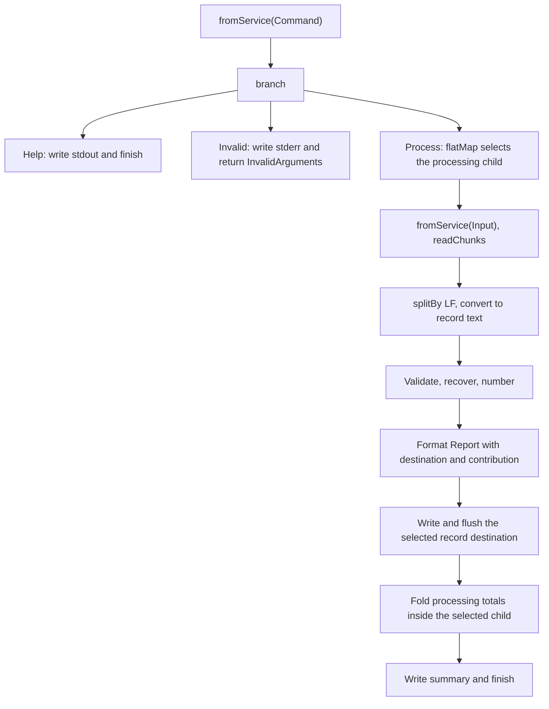

# Record processor

A finite import CLI built with zrx and Zig **0.17.0**. No third-party app
dependencies, external services or root-build/CI integration.

```sh
cd examples/apps/record-processor
zig build
printf ' ab-1 , Ada  Lovelace , 00042\nbad!,Bob,9\n' > input.txt
./zig-out/bin/record-processor --input input.txt --output normalized.txt
# normalized.txt: AB-1,Ada Lovelace,42
# stderr: record 2: InvalidIdentifier
# stdout: summary: accepted=1 rejected=1 amount_cents=42
# exit status: 1
printf 'x,Zed,7\n' | ./zig-out/bin/record-processor --output new.txt
./zig-out/bin/record-processor --help
```

The selected pipeline (resources are acquired before activation):



## Format and policies

- Exactly `identifier,name,amount_cents`, with no header, quoting, embedded
  commas or comments. LF frames records; a final unterminated record is accepted.
  One final CR is removed for CRLF. Blank lines are rejected records.
- Trim ASCII space/tab at field edges. Identifier: 1–32 ASCII letters, digits,
  `_` or `-`, normalized to uppercase. Name: 1–80 bytes before normalization;
  ASCII letters, digits, spaces, apostrophes, hyphens and dots, with repeated
  spaces collapsed. Amount: 1–32 ASCII decimal digits, integer cents from zero
  through 1,000,000,000; leading zeros are removed. No floats, signs or locale.
  Duplicate identifiers are independent records, not upserts.
- At most 256 bytes per input line excluding LF (including CR), and 10,000
  records including rejections. Excess bytes or records are **fatal**, not
  truncated input. Input expansion is synchronous; branch transport remains
  library-managed. There is no whole-file collection. Owned bounded values
  cross routing boundaries. LF framing is a `splitBy` stage across owned byte
  chunks; excess frame length produces an unhandled `FrameTooLong` operation
  error, not a schema rejection.
- Validation runs as named field/identifier/name/amount stages. The first
  failure becomes a pending operation error; narrow `recover` turns only schema
  errors into tagged rejections. A pure `scan` numbers all recovered outcomes.
  Validation handlers take/return ordinary `Record` values, not an outcome
  union. A success-only map wraps the validated record before recovery.
  `Report.fromNumbered` produces text, an explicit accepted/diagnostic
  destination and a summary contribution. The injected write handler dispatches
  only to that destination and flushes before forwarding its contribution.
  Reporting errors stay pending and fail the process summary fold; they are
  not turned into schema rejections or recursively reported.
  No default valid record is invented. `whenError` is unnecessary once errors
  are domain outcomes; no transient operations justify retries.
- Every command case terminates independently: help writes usage to stdout;
  invalid usage writes stderr and returns its command error; processing writes
  records, diagnostics and its own summary. There is no shared completion type,
  post-command aggregation or second output-routing branch. Run-owned resources
  provide distinct accepted-output and diagnostic-writer roles, with exclusive
  file creation and release after users join. Cleanup closes owned files but
  does not flush failed work or close process stdio. `execute` directly returns
  the pipeline's `anyerror!void`; there is no injected mutable exit-status cell.
  Writer effects and terminal error policy stay in `composition.zig`.
- One input recipe derives the nominal `Input { reader: *Reader }` role from
  `reader(inputConfig)`, just as output roles derive from writer recipes.
  The typed configuration provider injects `Command` and only selects file versus
  stdin; zrx owns allocation, opening, buffering and release. No second view
  resource is needed. Tests inject the same role with a borrowed, initialized
  reader owner. Help/invalid commands prepare
  borrowed stdin but never read it; preparing does not consume or close stdin.
  Output resources likewise own byte-oriented `Writer` values. Composition
  explicitly uses `writeLine` for records/summary and exact bytes plus a flush
  for help/usage; resource methods do not implicitly add LF or flush.
- An owned arguments resource acquires argv storage. A dependent immutable
  command recipe parses it into help, invalid or processing configuration.
  The command value borrows its argument referents and has no cleanup of its
  own, so that recipe uses an explicit `null` finalizer. Invalid usage is
  configuration data, not a failed constructor.
  `Command.fromArgs` in `src/domain/commands.zig` owns option policy, explicitly
  excluding argv[0]. The single selected pipeline starts at
  `fromService(Command)` and branches into help, invalid usage or processing.
  In the process subpipe, `flatMap(process)` constructs the cold `processRecords`
  child once for the selected command. That child starts from injected `Input`,
  reads byte chunks, splits on LF, validates and writes reports, then
  folds its own totals. A selected empty input emits the zero summary; no
  selected command means no child and no fold seed. This is synchronous typed
  expansion, not a new worker, queue, nested run or per-command resource scope.
  Help/invalid commands open no files and construct no input traversal.
  `main` supplies process capabilities and owns exit-code policy.
  All outcomes return after users join and resources release; unexpected errors
  get one best-effort stderr report with a stack buffer, not another pipeline
  or allocation. There are no nested runs or custom executors.
- Domain functions are handlers supplied to library operators. The command
  pipeline and its selected processing child are cold declarations: no tuple
  concatenation, custom operator protocol or test-only pipeline builder. Tests
  use the production command declaration with injected readers/writers.
  Pure value operations are methods (`Numbered.advance`/`isRejected`,
  `Summary.add`/`toText`, `Report.summary`), also usable as typed callbacks.
  Only `domain/records.zig` imports zrx to define bounded text aliases. Other
  domain files use those value types, not zrx APIs or resource services.
- Accepted output preserves input order; diagnostics preserve rejection order
  and contain the 1-based input record number and first validation category,
  not raw potentially sensitive input. Cross-stream ordering is unspecified.
  Output, each diagnostic and the summary always end with one LF.
- `--output NEW_PATH` is required. Input defaults to stdin; `--input PATH` reads
  a file and `--input -` explicitly selects stdin. Processing stdin waits for EOF
  (potentially waiting for terminal input); there is no automatic terminal
  detection. Help/invalid commands never read stdin. Relative paths use cwd.
  `--help` alone succeeds without opening files. Unknown, duplicate, missing-value
  and conflicting options fail usage validation.
- Exit **0**: all accepted (including empty input); **1**: finished with rejected
  records; **2**: configuration, allocation, limit, cancellation or I/O failure.
  After successful final output, the command terminals return
  `RejectedRecords` or `InvalidArguments` for those expected command outcomes;
  `main` maps them to 1 or 2 without printing another error. Help and clean
  processing return normally. Other pipeline errors get a fatal diagnostic
  and exit 2. This is the run's single error outcome, not an aggregate error list.
  The summary terminal runs only after all record writes and flushes succeed;
  `run` also requires the summary's stdout flush to succeed. Input, acquisition,
  record-reporting and limit failures suppress the summary. Fatal errors produce
  `fatal: ErrorName` on stderr. Final stdout failure can leave already-written
  summary bytes; fatal reporting is best-effort if stderr itself is broken.
- Output is exclusively created, including for empty input. Existing files,
  including aliases of input, are never silently overwritten. Equal textual
  input/output paths fail configuration first. This is **not atomic publication**:
  acquisition can leave a new empty file, and fatal runs can leave a normalized
  prefix and earlier diagnostics. Remove/review partial output explicitly before
  rerunning with the same destination. No rollback, fsync, durability or exactly-once
  guarantee. Source/acquisition/cancellation failures stay execution control,
  not record rejections; reporting I/O failures are unhandled operation errors.
  Reports are delivered serially; no diagnostic is silently dropped.

## Local checks

Run from this directory:

```sh
zig build
zig build test
zig build test -Doptimize=ReleaseFast
zig build check
```

`test` includes domain/CLI unit tests, non-processing command resource checks, the
production pipeline with injected policy and writer resources, reporting/final-
terminal failure tests, and actual executable simulations. `check` adds format
checking. Simulations use temporary files and finite file-backed stdin,
assert status/stdout/stderr/output and summary, and cancel/join/kill/reap on
failure with a 10-second per-process deadline (no sleeps or human input).
Fatal record-cap output is checked as a normalized prefix, not an exact
scheduler-dependent prefix length. Tests cover mixed and all-invalid input,
default/explicit stdin, empty/unterminated/CRLF input, byte/record bounds,
overwrite protection, missing paths, help and usage. They do not simulate
disk-full, broken stderr, external cancellation or crashes. Error names come from the native standard
library; the current executable simulations target hosted native execution,
not foreign-target execution.

## Layout

`composition.zig` contains the single declaration; `resources.zig` owns its
run-scoped I/O and configuration bindings. App-specific data and handlers are
grouped by responsibility, not hidden behind custom operators:

```text
src/
  main.zig                 OS exit and fatal-report policy
  app.zig                  Bindings and execution boundary
  composition.zig          Data journey, writer effects and terminal outcomes
  resources.zig            Acquisition/release and nominal I/O roles
  domain/
    commands.zig           Command parsing and usage
    records.zig            Bounded data, limits and value operations
    validation.zig         Parsing, validation and normalization handlers
    reporting.zig          Record text and delivery contributions
    summary.zig            Summary aggregation and text conversion
```

## Reuse review

| Capability | Location and policy boundary |
|---|---|
| Owned argv resource | zrx `arguments` / `Arguments`, preserving the full vector. Parsing options remains app policy. |
| Typed binding as input | zrx `fromService(T)` replaces the command request token/accessor. |
| Command into input stream | zrx `flatMap` drains cold synchronous declarations inside the selected process subpipe; `readChunks` and `splitBy` make byte input and framing explicit. |
| Byte input and framing | zrx `reader(inputConfig)` owns byte I/O and derives the `Input` role; `readChunks` emits owned chunks and `splitBy` frames across them. The app only selects configuration from `Command`. |
| Managed byte writers and line encoding | zrx `Writer`/`writer` share built-in ownership. Composition explicitly chooses `writeLine` versus exact byte writes. Role names and conditional file creation remain app policy. |
| Command dispatch and processing | All command cases terminate; only a selected process command constructs the child containing the summary fold. |
| Validation, numbering, report destinations and summary | Domain/CLI policy; keep local. No shared completion state or injected status sink. |
| OS exit codes | Chosen only in `main` from `execute`'s returned error or success. |
| Fatal-message reporting | A small allocation-free bootstrap boundary for `run` failures, not a new stream or generic operator. |

The app's configured writer recipes are mutually exclusive by immutable command.
They do not imply automatic endpoint/path conflict detection or locking for
general resource-backed writers.

The lifecycle boundary remains explicit: command parsing configures run-owned
resources before activation. The selected command then expands into their
input records inside the pipe. `flatMap` adds no child resource scope, dynamic
subscription or nested execution boundary.

Next review point: decide whether this deliberately small schema and partial-file
failure policy fit the intended import workflow before adding any new behavior.
