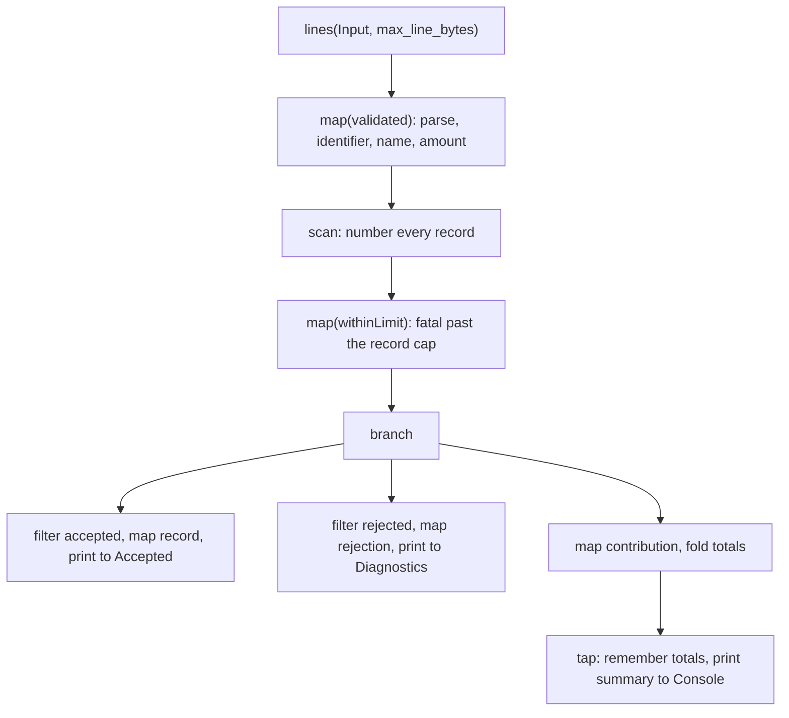

# Record processor

A finite import CLI built with zrx and Zig **0.17.0**: validate and normalize
`identifier,name,amount_cents` records, write the accepted ones to a new file,
report the rejected ones, and print a summary. No third-party dependencies.

```sh
cd examples/apps/record-processor
zig build
printf ' ab-1 , Ada  Lovelace , 00042\nbad!,Bob,9\n' > input.txt
./zig-out/bin/record-processor --input input.txt --output normalized.txt
# normalized.txt: AB-1,Ada Lovelace,42
# stderr: record 2: InvalidIdentifier
# stdout: summary: accepted=1 rejected=1 amount_cents=42
# exit status: 1
printf 'x,Zed,7\n' | ./zig-out/bin/record-processor --output new.txt
./zig-out/bin/record-processor --help
```

## The pipeline

All of it is one declaration in [`src/composition.zig`](src/composition.zig):

```zig
pub const records_pipe = pipe(.{
    map(validated),
    scan(Numbered{}, Numbered.advance),
    map(Numbered.withinLimit),
    branch(.{
        accepted_records,
        rejections,
        totals,
    }),
});
```



- The schema is four named handlers composed left to right; the first rule a
  line breaks becomes that record's outcome. A rejection is data, not a failed run.
- `Rules` (amount ceiling, record cap) is an injected dependency.
- The four destinations are roles: `Input`, `Accepted`, `Diagnostics`
  (`zrx.Stderr`) and `Console` (`zrx.Stdout`). Production provides the outputs
  with `Program.provide` using `stdout`, `stderr`, and a `fileWriter` in
  `.create_new` mode. Tests pass fixed readers and writers to the program.
- The summary is written only after record output has been flushed successfully.

`app.zig` is the boundary around it: it parses the command, opens the input,
runs the program and turns the totals into an outcome.
`main.zig` owns exit codes.

## Format and policies

- Exactly `identifier,name,amount_cents`: no header, quoting, embedded commas
  or comments. LF ends a record; a final unterminated record is accepted; one
  trailing CR is removed. Blank lines are rejected records.
- ASCII space and tab are trimmed at field edges. Identifier: 1–32 ASCII
  letters, digits, `_` or `-`, uppercased. Name: 1–80 bytes of ASCII letters,
  digits, spaces, apostrophes, hyphens and dots, repeated spaces collapsed.
  Amount: 1–32 decimal digits, integer cents from 0 through 1,000,000,000,
  leading zeros removed.
- At most 256 bytes per line excluding LF, and 10,000 records including
  rejected ones. Exceeding either is **fatal** (`StreamTooLong`,
  `TooManyRecords`), not truncated input.
- Accepted output keeps input order. A diagnostic carries the 1-based record
  number and the first broken rule, never the record's content.
- `--output NEW_PATH` is required and is created exclusively: an existing file,
  including the input, is never overwritten. Input defaults to stdin;
  `--input PATH` reads a file and `--input -` selects stdin.
- Exit **0**: all accepted (including empty input). **1**: finished, with
  rejected records. **2**: invalid usage, or a fatal I/O or limit error, which
  prints `fatal: ErrorName` to stderr and no summary.
- Not atomic: a fatal run can leave a new file holding the records written so
  far (always whole records), and a run that fails after the output is created
  leaves it behind. There is no rollback or durability guarantee.

## Checks

From this directory:

```sh
zig build
zig build test
zig build test -Doptimize=ReleaseFast
zig build check
```

`test` runs the domain unit tests, the production program with injected
readers and writers (including failing writers), and the real executable on
temporary files with its exit status, stdout, stderr and output file asserted.
Every executable run has a 10-second deadline and is killed and reaped on failure.

## Layout

```text
src/
  main.zig                 exit codes and the fatal report
  app.zig                  command dispatch, opening the input, running
  composition.zig          the pipeline and its roles
  domain/
    commands.zig           option parsing and usage
    records.zig            bounded data, outcomes, numbering, limits
    validation.zig         the schema, one handler per rule
    summary.zig            totals
```

## What this port needed from zrx

This app existed for the previous zrx and was rebuilt on the rewritten API
without changing the library, to find out what is missing. Two things it
needed were general and have since been added to zrx: `orElse`, which turns a
handler's error into a value (a rejected record has to continue downstream,
and `recover` can only skip), and the `.create_new` mode of `fileWriter`.

What is still worked around here, ordered by how much it shapes the code:

1. **A program has no result.** The caller needs the totals for the exit
   status, so `tap(remember)` stores them through a `*Summary` dependency.
2. **No source for "this file, or stdin".** `app.zig` opens the input and
   passes its reader as a dependency. (That also lets it fail on a missing
   input before any output file is created; a source opens later than that.)
3. **`print` only ends a pipe.** Writing records and then aggregating became a
   `branch` with a `filter` per destination. `print` flushes output in its own
   hooks.
4. **Choosing a program is plain Zig.** Help, invalid usage and processing are
   a `switch` in `app.zig`; a pipe cannot switch to another source.
5. **Owned bounded text.** The old `zrx.Line(n)` is gone; `records.zig`
   defines `Text(n)`.

What needed nothing: the record cap (`scan` numbers, a handler enforces),
injected rules, and testing the production pipe against in-memory I/O.
