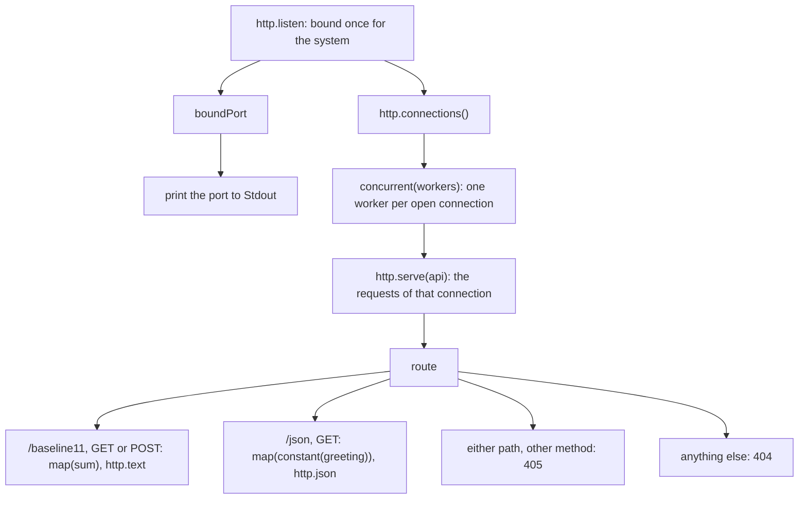

# HTTP benchmark

Two HTTP/1.1 servers with the same endpoints, built with Zig **0.17.0** to
be measured against each other. `http-bench` is a zrx system on
[`zrx.ext.http`](../../docs/guide.md#http). `http-bench-zig` is the same
server written against `std` alone: the baseline. No third-party
dependencies.

```sh
cd examples/http-bench
zig build -Doptimize=ReleaseFast
./zig-out/bin/http-bench serve 8080
# In a separate terminal:
curl 'http://127.0.0.1:8080/baseline11?a=13&b=42'        # 55
curl -d 20 'http://127.0.0.1:8080/baseline11?a=13&b=42'  # 75
curl 'http://127.0.0.1:8080/json'                        # {"message":"Hello, World!"}
```

`/baseline11` is the integer sum workload of the [HttpArena baseline
profile](https://http-arena.com/docs/test-profiles/h1/baseline/implementation/):
the sum of the query's values, plus the number in a `POST` body of at most
32 bytes. `/json` serializes a small object.

## The pipes

The zrx server is [`src/app.zig`](src/app.zig): two programs, three named
pipes and one handler.

```zig
/// What is done with a request.
pub const api = pipe(.{
    recover(anyerror, .{http.fail()}),
    route(.{
        when(all(.{ isBaseline, readsOrPosts }), sums),
        when(all(.{ isJson, http.method(.GET) }), greets),
        when(any(.{ isBaseline, isJson }), .{http.status(.method_not_allowed)}),
        otherwise(.{http.status(.not_found)}),
    }),
});

/// What is done with a connection: one of `workers` holds its conversation.
pub const server = program(http.connections(), .{
    concurrent(workers, .{
        recover(http.Disconnected, .{drain()}),
        http.serve(api),
    }),
});

/// Tells whoever started the server which port it listens on.
pub const announcement = program(fromProducer(u16, boundPort), .{print(Stdout, "{d}\n")}).provide(.{stdout(Stdout, 16)});

/// Both share the listener: bound once, announced, and accepted from.
pub const service = system(.{ announcement, server });
```



- The program's pipe carries connections; `api` carries the requests of one
  connection. `sums` and `greets` are the two answers, each a `map` and a
  responder.
- `recover(anyerror, .{http.fail()})` turns an error of `sum` (a body that
  is too large, has no length, or stands on a `GET`) into its status.
  `recover(http.Disconnected, .{drain()})` drops a connection that broke
  and lets the server go on.
- The listener is a resource given to `run`, so the system acquires it once
  for both programs. `announcement` is a program of one item: the bound
  port, printed. That is how `serve 0` tells its caller which port the
  system chose.
- `sum` is the one handler: it adds up the query's values and the body.

Both servers take the same command line, bind to loopback only, and print
the port they listen on. Both hold one connection per worker for as long as
it is open, with `-Dworkers=N` workers (16 unless given).

## The baseline

[`src/plain.zig`](src/plain.zig) uses `std.http.Server` directly: each
worker accepts a connection and serves it, and `respond` flushes every
response. It is the comparison, so it is written the way `std` suggests and
not as a pipe.

The two servers answer the workloads byte for byte alike, and refuse a body
they cannot take with the same status. A `GET` of `/json` that carries a
body is answered by both, with the body left alone and the connection
closed, and neither answers or judges an `Expect` on a request whose body
it does not read. They differ where zrx is stricter or
keeps a connection:

- After a 404 or 405 without a body the baseline closes the connection and
  zrx keeps it.
- zrx refuses a head a proxy could read differently (no `Host`, a field
  name that is not a token, and the rest of
  [the guide's list](../../docs/guide.md#failures)) with 400 before the
  pipe sees it. The baseline serves what `std` parsed.
- Neither reads a chunked body. zrx answers every `Transfer-Encoding` with
  411, and the baseline was made to do the same so that both serve the same
  requests. The profile's chunked `POST` is therefore not served by either.

## Compare

With Python 3 on Linux or macOS, and [`hey`](https://github.com/rakyll/hey)
for the workloads that do not pipeline:

```sh
zig build -Doptimize=ReleaseFast
python3 compare.py --workload baseline --runs 5
python3 compare.py --workload post --runs 5
python3 compare.py --workload json --runs 5
python3 compare.py --workload baseline --pipeline 1 --runs 5
python3 compare.py --workload baseline --pipeline 16 --requests 2560000 --runs 5
python3 compare.py --workload json --pipeline 16 --requests 2560000 --runs 5
```

Each run starts a fresh process on a port the system chooses, checks exact
responses over a reused connection, warms the server and requires every
response to succeed. It reports request throughput, p99 latency, the CPU
time the server used per request, and its peak RSS. `--pipeline N` sends `N`
requests per write with `http-bench-load`, a small client in this app,
because `hey` does not pipeline; `--pipeline 1` uses that client without
pipelining. Keep `--connections` (8 unless given) well below the worker
count: a load generator that briefly opens one connection more than there
are workers waits for a worker until its timeout. `--reference NAME=COMMAND`
adds a server that accepts `serve PORT` and prints its port; it can be given
several times, each with a name of its own.

## Measured

On 2026-11-19, with the six commands above, on an Apple M1 Pro (10 cores,
16 GB, macOS 27.2.1), zrx at `5c85c2a`, ReleaseFast, 16 workers, 8
keep-alive connections over loopback. Each cell is the median of 5 runs
with the range in parentheses. Other work was running on the machine (load
average 8 to 14), so read the ranges, not the last digits.

Requests per second:

| Workload | zrx | plain `std` |
|---|---|---|
| `baseline`, `hey` | 56,828 (56,453–57,917) | 56,893 (56,532–57,229) |
| `post`, `hey` | 55,804 (55,642–56,095) | 55,660 (55,399–56,236) |
| `json`, `hey` | 56,660 (56,470–56,899) | 56,963 (56,542–57,547) |
| `baseline`, 1 per write | 92,500 (92,011–100,680) | 91,856 (90,404–102,737) |
| `baseline`, 16 per write | 1,398,659 (1,341,526–1,488,645) | 284,892 (267,450–299,645) |
| `json`, 16 per write | 1,412,368 (1,374,243–1,491,759) | 292,663 (270,747–293,201) |

CPU time of the server per request, and its largest peak RSS:

| Workload | zrx | plain `std` |
|---|---|---|
| `baseline`, `hey` | 19.0 µs, 2.8 MiB | 18.4 µs, 2.6 MiB |
| `post`, `hey` | 19.5 µs, 2.8 MiB | 18.6 µs, 2.6 MiB |
| `json`, `hey` | 18.9 µs, 2.8 MiB | 18.4 µs, 2.7 MiB |
| `baseline`, 1 per write | 26.4 µs, 2.8 MiB | 26.5 µs, 2.7 MiB |
| `baseline`, 16 per write | 2.0 µs, 2.8 MiB | 17.8 µs, 2.6 MiB |
| `json`, 16 per write | 2.0 µs, 2.8 MiB | 17.3 µs, 2.6 MiB |

Median p99 was 0.30 ms per request for both servers on the three `hey`
workloads and 0.16 ms for both at 1 per write. At 16 per write it was
0.17 ms per batch for zrx and 0.64 to 0.65 ms for plain `std`.

Where zrx is slower or larger:

- With `hey`, zrx used 3 to 5 % more CPU per request than the baseline
  (0.5 to 0.9 µs) on all three workloads. Where that goes was not
  measured; zrx does check every head before the pipe sees it, which the
  baseline does not.
- Its peak RSS was 0.1 to 0.2 MiB larger in every row.
- Its median throughput was lower on `baseline` (by 0.1 %) and on `json`
  (by 0.5 %) with `hey`. Both differences are inside the spread between
  runs, as are the ones in zrx's favour on `post` and at 1 per write.

What this shows, and what it does not:

- One request per round trip costs the same in both, to within the spread.
  Each request is a read and a write on a socket, and that is where the
  time goes. With `hey` the load generator is the limit, which is why the
  same servers answer more than half as many requests again from
  `http-bench-load`.
- Pipelined requests are where the servers differ: zrx answered 4.8 to 4.9
  times as many, with about a ninth of the CPU per request, because it
  writes when the peer has sent nothing more instead of after every
  response. The baseline would gain the same by doing the same; it flushes
  per response because that is what `respond` does.
- Nothing here measures many connections, slow peers or large bodies, and a
  loopback run on one machine says little about a network.

## Checks

From this directory:

```sh
zig build
zig build test
zig build test -Doptimize=ReleaseFast
zig build check
```

`test` runs the command-line unit test, both servers over the same HTTP
fixtures through a reader and a writer supplied by the test
(`http.Transport` for zrx, which is the production `api` pipe), and the two
real executables: their usage and exit status, and one conversation each
over the network.

That last part departs from [the apps' rule](../README.md#checks) of no
network in executable runs: a server has to be reached through a socket.
The test starts `serve 0`, reads the port the executable announces, and
talks to it over loopback on that port, so nothing is fixed and nothing
leaves the machine. It waits on what the server sends, never for a length
of time. Every executable run has a 10-second deadline, and the server is
killed and reaped however the test ends. `check` adds formatting and builds
all three binaries.

## Layout

```text
src/
  main.zig         entry of http-bench
  app.zig          the zrx server: programs, pipes and the one handler
  plain_main.zig   entry of http-bench-zig
  plain.zig        the baseline, on std alone
  cli.zig          the command line both share, and the fatal report
  load.zig         http-bench-load, a client that can pipeline
tests/
  integration.zig  both servers on the same fixtures; the executables
compare.py         runs the servers under load and reports
```

## What this app needed from zrx

This app existed for the previous zrx, where it ran a program per connection
inside a hand-written accept loop. It was rebuilt on `zrx.ext.http` without
changing the library. What is still worked around here, ordered by how much
it shapes the app:

1. **A worker count known only when the program starts.** `concurrent`
   takes a comptime count, so the count moved from the command line to the
   build option `-Dworkers`, for both servers.
2. **More open connections than workers.** A worker holds a connection for
   as long as it is open, idle or not, so the load has to stay below the
   worker count and nothing here measures many connections.
3. **Chunked request bodies.** They are answered 411, so the profile's
   chunked `POST` is not served, and the baseline was changed to match.
4. **Folding something that is not a slice.** `reduce` folds an array, a
   slice or a batch. A query is an iterator of pairs, so adding up its
   values is a loop in the handler `sum`.

What needed nothing: routing by path and method, the statuses of a refused
body (`http.fail`), a lost peer (`http.Disconnected`), testing the
production `api` pipe against in-memory I/O (`http.Transport`), and
announcing the port, which is a second program in the system that shares
the listener.
