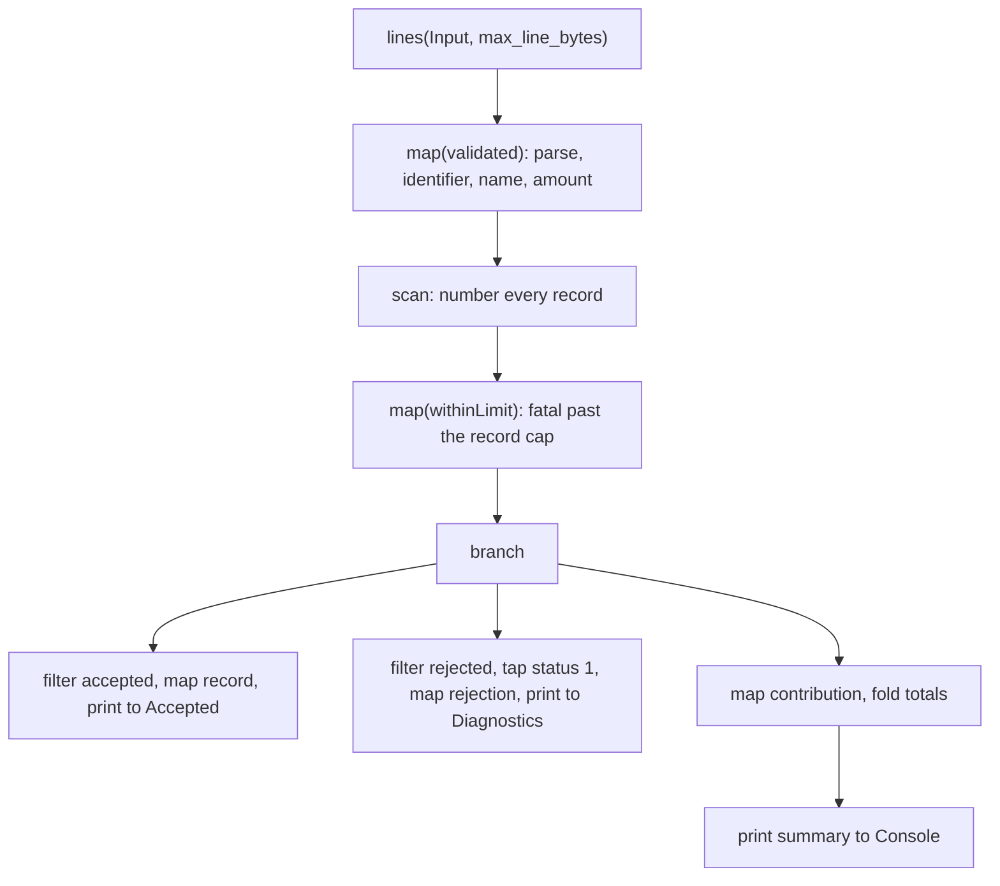

# Record processor

A finite import CLI built with zrx and Zig **0.17.0**: validate and normalize
`identifier,name,amount_cents` records, write the accepted ones to a new file,
report the rejected ones, and print a summary. No third-party dependencies.

```sh
cd examples/record-processor
zig build
printf ' ab-1 , Ada  Lovelace , 00042\nbad!,Bob,9\n' > input.txt
./zig-out/bin/record-processor --input input.txt --output normalized.txt
# normalized.txt: AB-1,Ada Lovelace,42
# stderr: record 2: InvalidIdentifier
# stdout: summary: accepted=1 rejected=1 amount_cents=42
# exit status: 1
printf 'x,Zed,7\n' | ./zig-out/bin/record-processor --output new.txt
./zig-out/bin/record-processor --help
```

## The pipeline

All of it is one declaration in [`src/composition.zig`](src/composition.zig):

```zig
pub const records_pipe = pipe(.{
    map(validated),
    scan(Numbered{}, Numbered.advance),
    map(Numbered.withinLimit),
    branch(.{
        accepted_records,
        rejections,
        totals,
    }),
});
```



- The schema is four named handlers composed left to right; the first rule a
  line breaks becomes that record's outcome. A rejection is data, not a failed run.
- `Rules` (amount ceiling, record cap) is an injected dependency.
- The four destinations are roles: `Input`, `Accepted`, `Diagnostics`
  (`process.Stderr`) and `Console` (`process.Stdout`). The program provides
  `stdout` and `stderr` as defaults; a production run binds the input it
  opened as `Input` and adds a `fileWriter` in `.create_new` mode for the
  output. Tests pass fixed readers and writers to the same program, which
  replace the defaults.
- The summary is written only after record output has been flushed successfully.

`app.zig` is the boundary around it: it parses the command and runs the
program with the bindings the command names. A run returns nothing: a
rejected record leaves status 1 where it is reported (`process.status`),
and what fails the run goes to `rescue(fatal)`, a `process.fail`, which
writes the `fatal:` line and sets status 2. `main.zig` returns the status.

## Format and policies

- Exactly `identifier,name,amount_cents`: no header, quoting, embedded commas
  or comments. LF ends a record; a final unterminated record is accepted; one
  trailing CR is removed. Blank lines are rejected records.
- ASCII space and tab are trimmed at field edges. Identifier: 1–32 ASCII
  letters, digits, `_` or `-`, uppercased. Name: 1–80 bytes of ASCII letters,
  digits, spaces, apostrophes, hyphens and dots, repeated spaces collapsed.
  Amount: 1–32 decimal digits, integer cents from 0 through 1,000,000,000,
  leading zeros removed.
- At most 256 bytes per line excluding LF, and 10,000 records including
  rejected ones. Exceeding either is **fatal** (`StreamTooLong`,
  `TooManyRecords`), not truncated input.
- Accepted output keeps input order. A diagnostic carries the 1-based record
  number and the first broken rule, never the record's content.
- `--output NEW_PATH` is required and is created exclusively: an existing file,
  including the input, is never overwritten. Input defaults to stdin;
  `--input PATH` reads a file and `--input -` selects stdin. Either is read
  on from where its descriptor stands: `--input /dev/fd/0` continues what
  read the same input before, where the system shares that position
  (macOS; on Linux the path opens the file anew).
- Exit **0**: all accepted (including empty input). **1**: finished, with
  rejected records. **2**: invalid usage, or a fatal I/O or limit error, which
  prints `fatal: ErrorName` to stderr and no summary.
- Not atomic: a fatal run can leave a new file holding the records written so
  far (always whole records), and a run that fails after the output is created
  leaves it behind. There is no rollback or durability guarantee.

## Checks

From this directory:

```sh
zig build
zig build test
zig build test -Doptimize=ReleaseFast
zig build check
```

`test` runs the domain unit tests, the production program with injected
readers and writers (including failing writers), and the real executable on
temporary files with its exit status, stdout, stderr and output file asserted.
Every executable run has a 10-second deadline and is killed and reaped on failure.

## Layout

```text
src/
  main.zig                 the arguments in, the exit status out
  app.zig                  command dispatch, the bindings of a run, the fatal report
  composition.zig          the pipeline and its roles
  domain/
    commands.zig           option parsing and usage
    records.zig            bounded data, outcomes, numbering, limits
    validation.zig         the schema, one handler per rule
    summary.zig            totals
```

## What this port needed from zrx

This app existed for the previous zrx and was rebuilt on the rewritten API
without changing the library, to find out what is missing. What it needed
that was general has since been added to zrx: `orElse`, which turns a
handler's error into a value (a rejected record has to continue downstream,
and `recover` takes the item out of the pipe), the `.create_new` mode of `fileWriter`, and
`fileReader`, with which the input is a binding like the output. Bindings
are acquired in the order they are written, so the input is opened before
the output is created and a missing input leaves no file behind.

The input no longer comes from `fileReader`, though. `app.zig` opens it
itself, before the run, and binds a streaming reader as `Input`, because
`fileReader` reads by position from the start of the file. A path that
names a descriptor already partly read, `/dev/fd/0` on macOS, was then read
from its start: an earlier version of this app used `fileReader` and wrote
both records where the input stood at the second. Whether `fileReader`
should read on from where its descriptor stands is a question for the
library, recorded here and not decided.

What is still plain Zig here:

1. **Choosing a program.** Help, invalid usage and processing are a `switch`
   in `app.zig`. "This file, or stdin" is not a choice of program: it is
   one program over `lines(Input, n)`, given a reader of whichever file
   `app.zig` opened.
2. **`print` ends a pipe.** Writing records and then aggregating is a
   `branch` with a `filter` per destination.
3. **Taking a line apart.** `validation.parseFields` splits a line into its
   columns by hand, where the other line-based apps use a
   [text pattern](../../docs/guide.md#text-patterns). A pattern answers
   yes or no for a line. This app reports *which* rule a line broke first
   (`MalformedFields`, `InvalidIdentifier`, `InvalidName`, `InvalidAmount`),
   and a column that is too long is one of those reasons, not "no record".
   So the columns stay a function and the rules stay the stages after it.

What needed nothing: the record cap (`scan` numbers, a handler enforces),
injected rules, testing the production pipe against in-memory I/O, and the
exit status. A run returns nothing, and what it produces is an effect of
its pipe: `tap(process.status(1))` on the path of a rejected record raises
the status through a `*process.Exit` dependency. An earlier version stored
the totals through a `*Summary` and had the caller look at them after the
run. Bounded text for a field
(`Text(n)` in `records.zig`) is the domain's own type.
